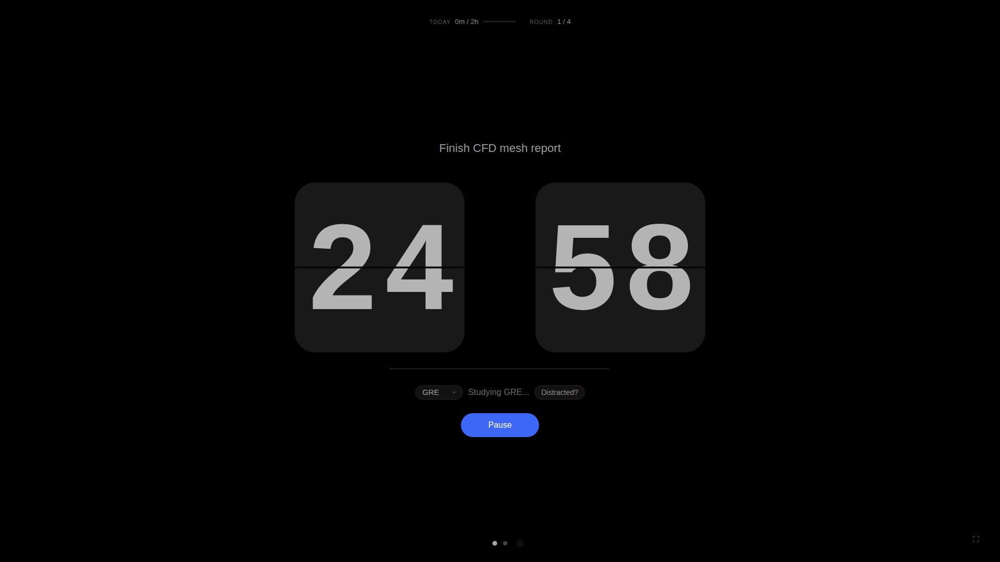
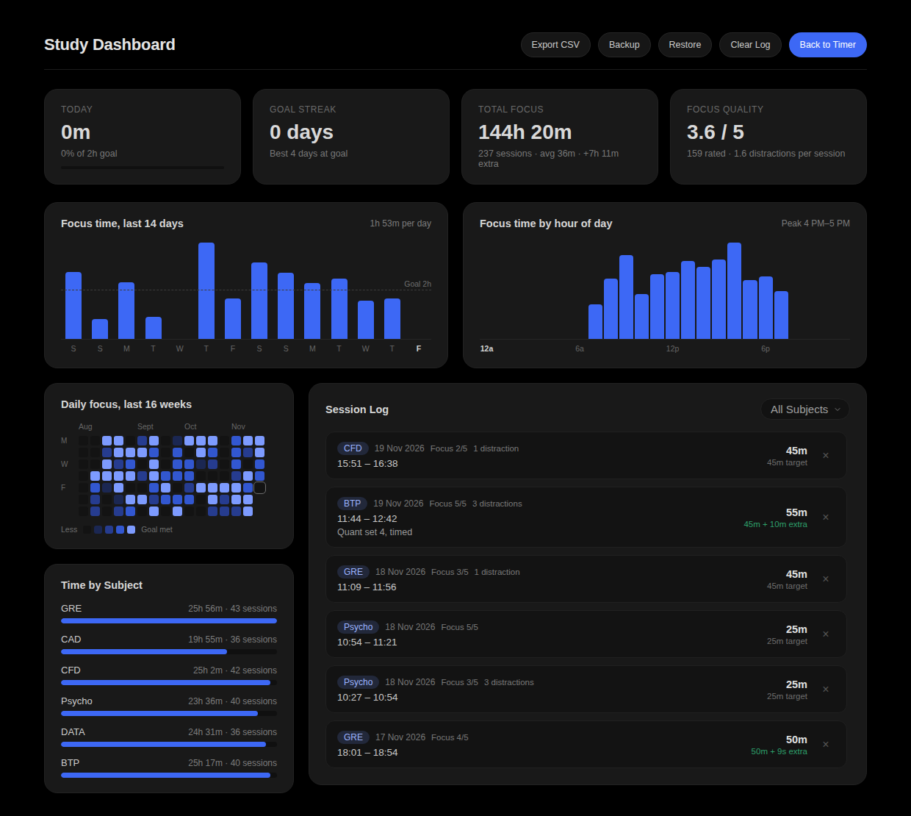

# Flip Clock Focus

A flip-clock focus timer with a study dashboard, in a single HTML file. No install, no build step, no account, and it works offline.

## Run it

Open `Clock.html` in a browser. That is the whole setup.

Press `F` for fullscreen. The layout is tuned for a 1920×1080 screen and scales to other sizes, including narrow windows.

## What it does

**Timer**

- Flip-clock countdown that keeps counting up as "extra focus" once the target is reached, until you finish the session.
- Intention line above the clock: type the one thing for this session, press Enter to start. It is saved with the session.
- Breaks after each finished session: 5 minutes, or 15 minutes every 4th round. Lengths are adjustable, and auto-breaks can be turned off.
- End & Log: pause, then log the time you actually focused instead of losing it. Sessions under a minute are not logged.
- Distraction counter during a session, and a 1–5 focus rating afterwards.
- Daily goal, goal streak and current round shown along the top.
- Zen mode: after a few seconds without input, everything except the clock, the intention and the progress line fades out.
- Ambient brown, pink or white noise, generated in the browser and played only while focusing.
- Keeps the screen awake during a session, and can send a desktop notification when the tab is hidden.
- The timer survives a reload or a closed tab: it picks up where the clock should be.

**Dashboard** (press `D` or scroll down)

*The dashboard screenshot uses generated sample data.*

- Today against your goal, current and best streak, total focus time, and focus quality.
- Focus time for the last 14 days, focus by hour of day, and a 16-week heatmap.
- Time by subject and a filterable session log.
- Export the log as CSV, or back up and restore everything as JSON.

## Shortcuts

| Key | Action |
| --- | --- |
| `Space` | Start, pause, resume, finish the session, or skip a break |
| `E` | End the session early and log it |
| `X` | Log a distraction |
| `B` | Start or skip a break |
| `R` | Reset (only when the timer is not running) |
| `M` | Cycle ambient sound |
| `1`–`5` | Rate the last session |
| `D` | Open or close the dashboard |
| `S` | Open or close settings |
| `F` | Toggle fullscreen |
| `Esc` | Close settings or the dashboard |

## Settings

Press `S` or use the gear icon next to the dots at the bottom of the screen. You can change the focus length, break lengths, daily goal, ambient sound and volume, the chime, notifications and zen mode, and rename or add subjects (up to 12).

## Your data

Everything is stored in the browser's `localStorage` for the page. Nothing is sent anywhere.

That also means the data lives in one browser on one machine, and clearing site data deletes it. Use **Backup** on the dashboard to download a JSON copy, and **Restore** to merge a backup back in. Restoring the same backup twice does not create duplicates.

## Browser support

Built and checked in Chrome. The screen wake lock and notifications depend on browser support and permissions; the timer works without them.
